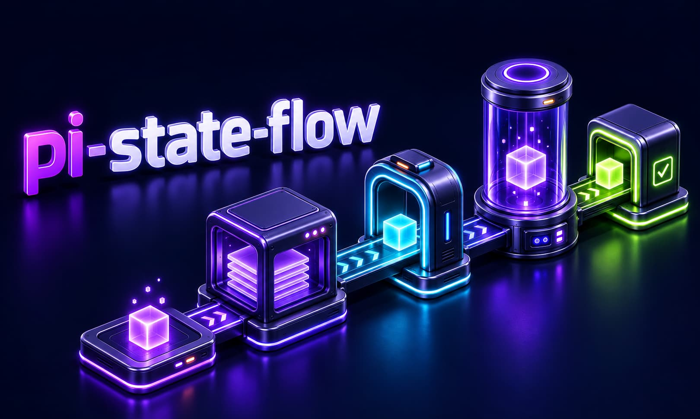

# Pi State Flow



**Keep the decisions. Keep Pi’s tool loop.**

State Flow gives Pi durable, structured memory across requests and sessions. Choose **when** to use memory (mode), **where** it belongs (scope), and **what** it records (semantic plane). Six planes come built in; companion extensions can add their own.

In Active mode, accepted memory carries continuity between runs instead of the completed conversation. Pi still runs the tools and keeps the inspectable session trace.

## Installation and activation

Requires **Pi 1.0.0+** and **Node.js 22.19.0+**. If you already have a store, check [supported formats and backups](docs/usage.md#moving-a-store-and-supported-formats) before upgrading.

Install from npm in your shell:

```bash
pi install npm:@llblab/pi-state-flow
```

Or from Git:

```bash
pi install git:github.com/llblab/pi-state-flow
```

New sessions default to **Off**. To enable Active for this session, run this in Pi:

```text
/state-flow-active
```

Starting Active in an existing conversation keeps its available context for one run so the agent can record what matters. Inspect memory with `/state-flow-status`.

## How it works

The explicit-state idea comes from [SKILL.state](https://arxiv.org/html/2608.26263v2). State Flow separates what carries forward from what the agent needs while working:

- **During the run:** Pi keeps the working conversation and tool trajectory. The agent patches memory when something worth keeping changes; it returns an ordinary answer, not a separate finalization call.
- **Between Active runs:** Accepted memory and compact recent changes carry continuity. Completed text leaves model context, not the native trace. Native compaction remains available.

This can reduce repeated transcript processing without guaranteeing lower latency or cost. See [what enters model context](docs/architecture.md#model-context-presentation) and [performance evidence](docs/performance.md).

## State model

### Active, passive, off

- **Active** — `/state-flow-active` carries accepted memory between runs while Pi keeps the current request, tool results and steering in context.
- **Passive** — `/state-flow-passive` keeps ordinary conversation continuity. Memory tools remain available, and validated memory can appear in context.
- **Off** — `/state-flow-off` removes State Flow tools and context without deleting stored memory or Pi history.

Mode changes are local to the session. See [mode behavior and defaults](docs/usage.md#active-passive-and-configured-off) and [Telegram controls](docs/usage.md#telegram-controls).

### Scopes and effective memory

- `global` — Across projects, such as stable user preferences.
- `cwd` — Across sessions in one working directory, such as a project’s checks.
- `session` — Private to the current session, such as its next action.

Participating scopes form one **effective view**: Global → CWD → Session. More specific values override broader ones; deleting a local value can reveal an inherited one. Effective is a view, not a writable fourth scope.

All three scopes participate by default. To choose only project memory, use `/state-flow-active cwd`. Omitting scope arguments keeps the session’s captured choice; selecting a scope never moves data into it. See [scope selection and availability](docs/usage.md#lifecycle-operations).

### Semantic planes

A scope tells you **who owns a value**; a plane tells you **what the value is for**. State Flow has six built-in planes:

- **`intents` — Commitments.** Chosen actions or outcomes still to pursue, not ideas merely discussed.
- **`strategy` — Decisions and constraints.** What governs the work, which approach was chosen, and why.
- **`tactics` — Execution state.** Verified progress, blockers, and the next useful check or action.
- **`artifacts` — Source-linked knowledge.** Exact source paths, descriptions, and compiled findings.
- **`response` — Last accepted answer.** The runtime records it in Active when Session participates; the agent does not patch it.
- **`lazy` — Detail on demand.** Notes, procedures, and evidence the agent reads explicitly instead of carrying in automatic context.

See [worked examples](docs/semantic-layers.md) and [progressive lazy reads](docs/lazy-state.md).

### Custom semantic planes

State Flow is also a **platform for domain-specific memory**. A regular Pi companion extension can register a typed plane through the public `@llblab/pi-state-flow/modules` API. For example, a code-review companion could keep structured findings in `x_acme_reviews` and surface the relevant ones in context. The companion defines and validates its data; State Flow handles scoped storage, history, and read access. Compatible mutable planes can also use the existing patch tool.

[Build a companion module](docs/public-module-contract.md#public-entry-and-lifecycle) with the minimal TypeScript example. No fork of State Flow is needed.

## Incremental updates and history

**Example:** Tell the agent, “Remember for this project: run `npm test` before publishing.” With multiple participating scopes including CWD, the agent can call `state_flow_patch` with:

```json
{
  "cwd": {
    "strategy": {
      "releaseCheck": "Run npm test"
    }
  }
}
```

To check the rule, read `cwd.strategy.releaseCheck` with `state_flow_read`:

```json
{"path":"cwd.strategy.releaseCheck"}
```

A successful read returns `{ "value": "Run npm test" }`. With only CWD selected, omit the `cwd` wrapper from the patch and the `cwd.` prefix from the path.

Patches commit atomically across supplied owners, and a semantic no-op advances no history. `effective[1].strategy` reads the preceding accepted boundary when retained; offsets count accepted semantic changes, not chat messages. See [tool contracts and examples](docs/architecture.md#model-tools), including [legacy tool names](docs/compatibility.md#tool-name-compatibility).

## Persistence, backups and continuity

The default store is `~/.pi/agent/state-flow/`. Resume and tree navigation use current same-session memory, not an old revision at the selected Pi step. When a fork acquires Session, it copies the parent’s **current** private memory once, not an older native step. See [fork support](docs/usage.md#fork-support-and-limits) and [storage recovery](docs/usage.md#storage-and-recovery).

Optional Git backup is not memory authority. Writes use per-file atomic replacement, not power-loss-safe or crash-atomic storage. If Active reports `active (blocked)`, fix the reported cause before retrying Active or Passive; choose Off for native chat without memory access. See [recovery and durability](docs/filesystem-recovery.md).

## Operational boundaries

State Flow adds memory, not a scheduler, background inference or automatic reference loading. It neither caps the size of state or the current trajectory nor undoes external tool effects. Stored observations can be wrong or stale; revalidate them before consequential actions. Treat stored state, logs and backups as private. Removing a current value does not erase older history or copies. Dedicated memory cleanup runs only on request.

## Documentation and development

- [Documentation index](docs/README.md) — Start here to find the guide or governing contract.
- [Usage and recovery](docs/usage.md) — Configure, inspect or recover memory.
- [State Flow Skill](skills/state-flow/SKILL.md) — The in-Pi guide, available as `/skill:state-flow`.
- [SDK compatibility](docs/compatibility.md) — Supported hosts, library APIs and verification limits.
- [Public modules](docs/public-module-contract.md) — Trusted companion-extension callbacks, not sandboxed plugins.
- [Acceptance map](docs/temporal-acceptance.md) — Guarantees tied to deterministic tests, not live-model or installed-client claims.

From a source checkout, run `npm install` and `npm run validate`. See `benchmarks/README.md` for opt-in measurements. Project context: [AGENTS.md](AGENTS.md), [BACKLOG.md](BACKLOG.md), [CHANGELOG.md](CHANGELOG.md).
